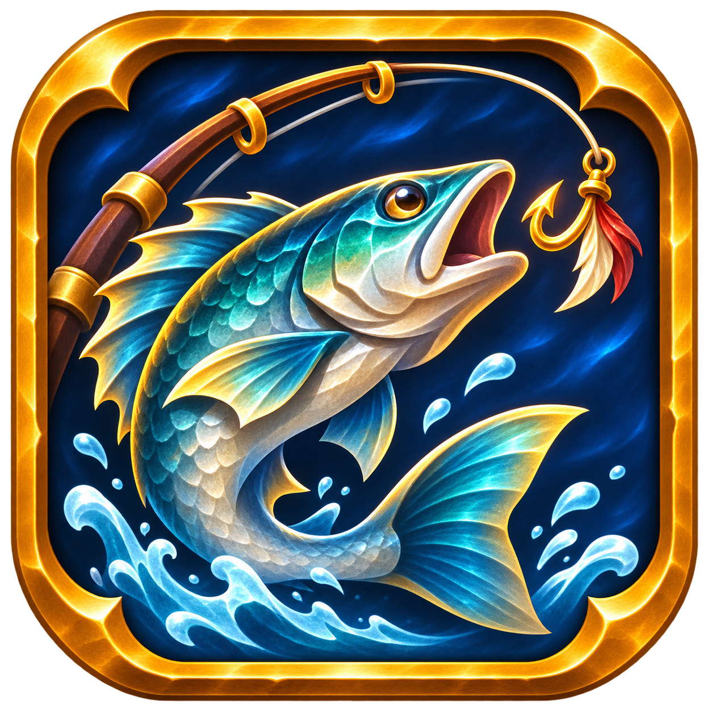

# Master Angler

<p align="center">
  
</p>

Fishing quality of life addon for WoW Forever.

## Features

- Double right-click on the game world: applies the strongest lure when the pole needs one, otherwise casts Fishing. While the line is out, it reels in the bobber (the Interact action), anywhere on the screen. It works with a fishing pole in the main hand, out of combat.
- Auto-lure: a lure is applied when the pole has none or less than 30 seconds left. With no lure in the bags, the cast happens without one.
- Interact key: with a pole in hand, the game's Interact key (set it in the Key Bindings menu) applies a lure or casts. It does its normal action when the line is out, for 1 second after the line comes in, near a soft-interact target, with a vendor, loot, quest or similar window open, in combat, or when the setting "Interact key casts" is off.
- Catch log: each item that you loot from a fishing loot window is stored for the character with zone, position, server time and game time. Coins are not stored.
- Fish journal: a window with every fish that the character caught, in four columns with icon and name. A search box filters the list. A click on a fish opens its detail: totals, first and last catch, and the zones where you caught it. "Go back" returns to the list with the filter kept. Fish that only another character of the account caught show as `???`.
- Minimap button: left-click opens the journal.
- Sound profile: a fishing pole in hand mutes music, ambience and dialog and raises effects. The old values return when you take the pole off, also after a crash.

## Install

```
make link WOW_DIR="/path/to/World of Warcraft/_forever_"
```

Use `make install` to copy the addon instead of a link.

## Commands

- `/masterangler` or `/masterangler help` lists all commands.
- `/masterangler journal` opens or closes the fish journal.
- `/masterangler minimap` shows or hides the minimap button.
- `/masterangler stats` prints the number of catches of the character.

## Sound profile notes

- The profile can be turned off in the settings panel.
- If you change a sound slider while the pole is in hand, the old value returns when you take the pole off.
- The old values stay in `MasterAnglerDB.cvarBackup` until they are restored.

## Languages

enUS (also enGB), deDE, esES, esMX, frFR, itIT, ptBR. Other locales use enUS.
The translations were written by the agent. No native speaker reviewed them.

## Development

`make deps`, `make test`, `make lint`, `make fmt-check`, `make coverage`.
Manual checks are in `docs/manual-checklist.md`.

## License

MIT, see `LICENSE`. The bundled libraries keep their own licenses in `MasterAngler/Libs/LICENSES.txt`.

## CI and release

- `.github/workflows/ci.yml` runs luacheck, stylua, busted with coverage and a package build on each pull request and each push to `main`.
- `.github/workflows/release.yml` publishes to CurseForge and GitHub on a tag `v*`.
- The CurseForge project ID is in the TOC. Before the first release, add the `CF_API_TOKEN` repository secret.
- Keep the TOC `Version` equal to the top `CHANGELOG.md` heading.
